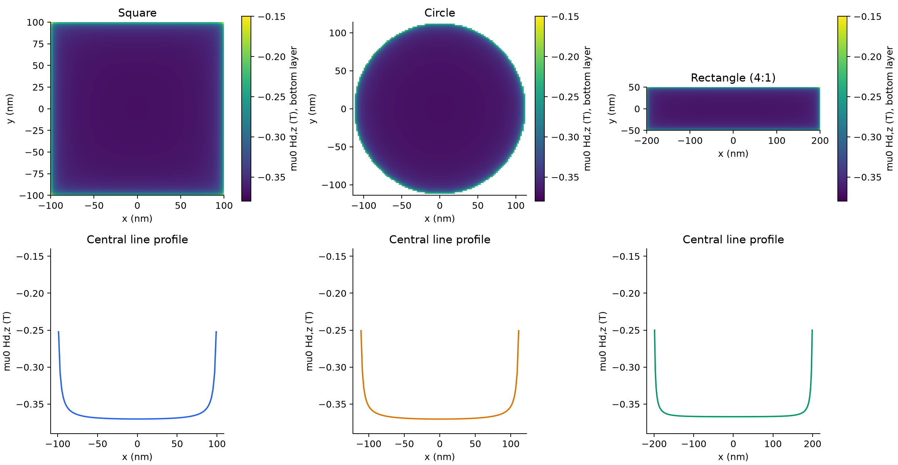
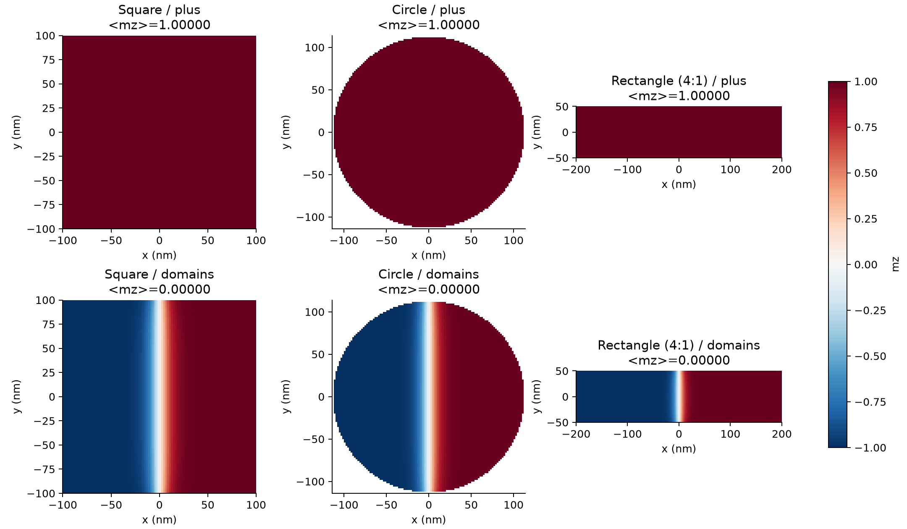
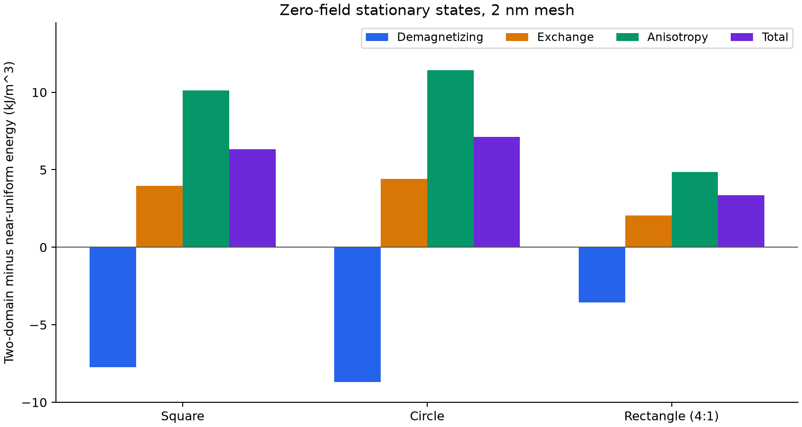
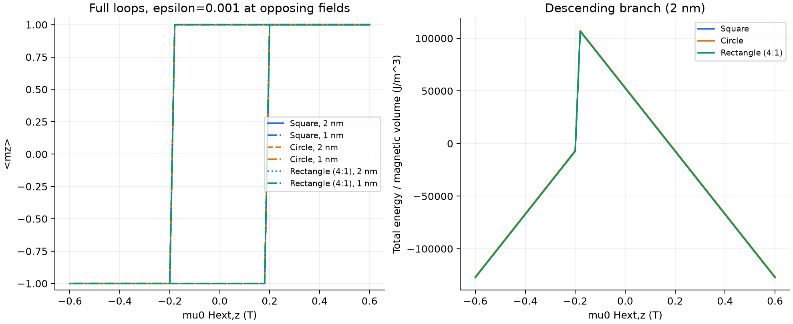
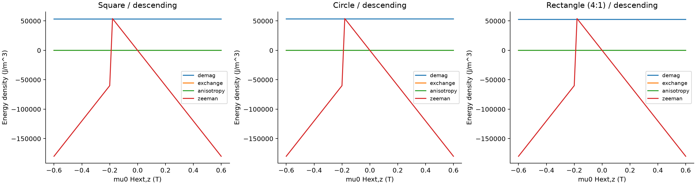
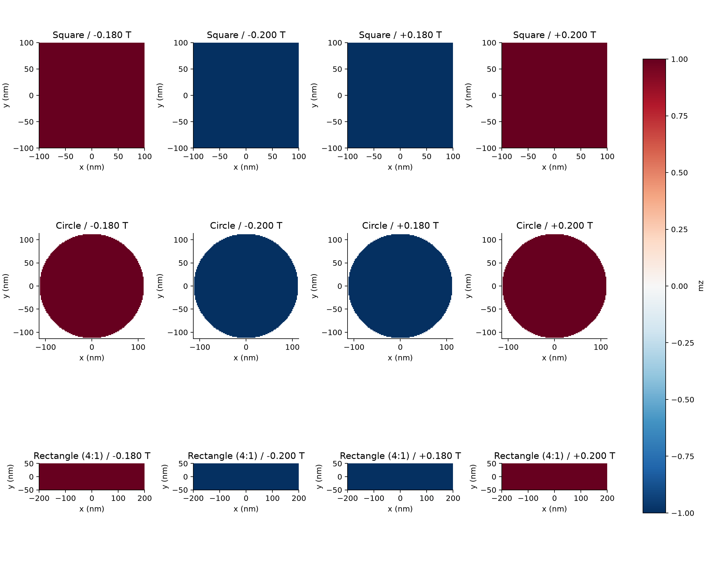
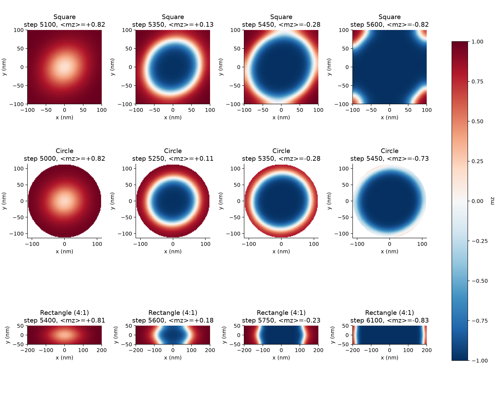
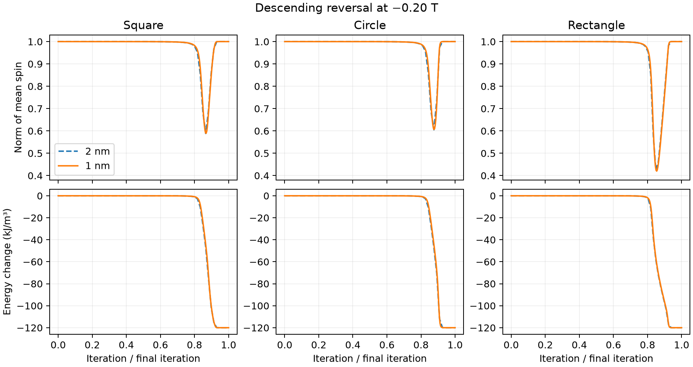

# 三种薄膜形状的退磁场与准静态翻转

状态：全部已列数值验收通过。

正式磁滞采用统一 ε=10⁻³ 横向扰动协议，仅在外场与上一态平均磁化反向的场点施加。原始无扰动曲线留作驻点诊断，不用于下面的矫顽场统计。详见 [实施记录](DECISIONS.md)。

## 固定均匀磁化的退磁因子

| 形状 | 网格/nm | Nx | Ny | Nz | 实际面积/nm² |
|---|---:|---:|---:|---:|---:|
| square | 2 | 0.029568913 | 0.029568913 | 0.940862174 | 40000 |
| square | 1 | 0.029568913 | 0.029568913 | 0.940862174 | 40000 |
| circle | 2 | 0.028018126 | 0.028018126 | 0.943963748 | 39936 |
| circle | 1 | 0.027854473 | 0.027854473 | 0.944291053 | 40000 |
| rectangle | 2 | 0.013690285 | 0.057140628 | 0.929169087 | 40000 |
| rectangle | 1 | 0.013690285 | 0.057140628 | 0.929169087 | 40000 |

## 2 nm 网格的多初态能量竞争

| 形状 | 近单畴能量密度/J·m⁻³ | 双畴能量密度/J·m⁻³ | 双畴减近单畴/J·m⁻³ | 双畴平均绝对 mz |
|---|---:|---:|---:|---:|
| square | 53203.64 | 59534.87 | 6331.24 | 0.91275 |
| circle | 53379.11 | 60485.45 | 7106.34 | 0.90154 |
| rectangle | 52542.19 | 55896.67 | 3354.49 | 0.95795 |

在当前测试的零场初态中，三种形状的近单畴态均比双畴驻态能量低。分畴降低退磁能，但增加的交换能与各向异性能更大。双畴态的平均 mz 接近零，而平均绝对 mz 仍接近 1，说明净磁化抵消来自上下畴，并非整体面内磁化。该比较仅覆盖本次初态集合。

## 磁滞指标

| 形状 | 网格/nm | Mr+/Ms | Mr−/Ms | 两支粗场步翻转区间/T |
|---|---:|---:|---:|---|
| square | 2 | 0.999999847 | -0.999999847 | [[-0.18, -0.2], [0.18, 0.2]] |
| square | 1 | 0.999999854 | -0.999999854 | [[-0.18, -0.2], [0.18, 0.2]] |
| circle | 2 | 0.999999861 | -0.999999861 | [[-0.18, -0.2], [0.18, 0.2]] |
| circle | 1 | 0.999999867 | -0.999999867 | [[-0.18, -0.2], [0.18, 0.2]] |
| rectangle | 2 | 0.999999808 | -0.999999808 | [[-0.18, -0.2], [0.18, 0.2]] |
| rectangle | 1 | 0.999999817 | -0.999999817 | [[-0.18, -0.2], [0.18, 0.2]] |

三种形状在当前零温、无缺陷模型及相同场历史下，撤场后的面外剩磁均接近饱和。末尾小数的微小差别不用于形状优劣排序；翻转场比较使用下面的区间与数值复核。

### 加密后的矫顽场

| 形状 | 网格/nm | 负支翻转夹逼/T | 正支翻转夹逼/T | 矫顽场估计/T | 矫顽场夹逼/T |
|---|---:|---|---|---:|---|
| square | 2 | [-0.1850, -0.1800] | [0.1800, 0.1850] | 0.1825 | [0.1800, 0.1850] |
| square | 1 | [-0.1850, -0.1800] | [0.1800, 0.1850] | 0.1825 | [0.1800, 0.1850] |
| circle | 2 | [-0.1850, -0.1800] | [0.1800, 0.1850] | 0.1825 | [0.1800, 0.1850] |
| circle | 1 | [-0.1850, -0.1800] | [0.1800, 0.1850] | 0.1825 | [0.1800, 0.1850] |
| rectangle | 2 | [-0.1850, -0.1800] | [0.1800, 0.1850] | 0.1825 | [0.1800, 0.1850] |
| rectangle | 1 | [-0.1850, -0.1800] | [0.1800, 0.1850] | 0.1825 | [0.1800, 0.1850] |

矫顽场幅值定义为 (bc+−bc−)/2，采用两支翻转区间传播得到夹逼范围。它表示离散场步下的区间，不是重复抽样的统计置信区间。在 5 mT 分辨率下，三种形状的矫顽场无法排序。

## 2 nm 网格的代表翻转过程

对每种形状的下降支首个翻转场点重放，保持原始初态、外场和求解参数，仅增加每 50 个接受步保存一次磁化的输出。图中标注求解器迭代步，不作为物理翻转时间。

| 形状 | 外场/T | 保存快照数 | 最小平均磁化矢量模长 | 与原终态最大磁化分量差 |
|---|---:|---:|---:|---:|
| square | -0.200 | 126 | 0.58866 | 0 |
| circle | -0.200 | 123 | 0.60507 | 0 |
| rectangle | -0.200 | 136 | 0.42423 | 0 |

平均磁化矢量模长明显小于 1 表明中间过程存在空间不均匀，不能仅凭翻转前后均为近单畴态就认定为一致旋转。具体空间变化见下方快照；这些是给定外场与初始化协议下的零温数值弛豫过程。
快照显示底层网格的 mz，平均量在整个磁性体积内计算。
在本次 −0.20 T 重放快照中，方形和圆形先在中心形成反向区域，再向外扩展；长方形形成中央反向带并向两端推进。该空间过程的描述限定于这组参数、网格和场点，不把关闭进动的迭代快慢解释为物理翻转速度。

## 验收记录

未完成项目：无。
未通过检查：当前已执行检查中无。
细化场区间、扰动结果和每项布尔检查见 [results.json](results.json)。
每个算例的 config.json 保存初态、前驱状态校验和、外场路径和输入校验和；summary.json 保存每个场点的磁性体积平均、能量和收敛记录。

## 图表与解释范围

所有参数均为教学模型，零温、无缺陷、关闭进动。多初态结果是所测试初态的驻态，不是基态证明；磁滞中的零场点才用于报告剩磁。关闭进动的积分时间不代表物理翻转时间。微磁学结果不直接证明 QAH 或量子化霍尔电导。

## 为什么长方形的平均退磁因子较低，翻转场仍落在相近区间？

三种形状在 2 nm 和 1 nm 网格的下降支与返回支均通过验证。12 条支路的翻转场绝对值均落在 180–185 mT。要解释这个观察，需要区分两个空间尺度。体积平均退磁因子描述整片薄膜在均匀磁化时的退磁能。翻转始于局部，中心磁化所处的退磁场与全片平均场有明显差别。

六个静态算例均固定均匀 +z 磁化。中心点取距几何轴最近的四个面内网格柱，核心取以几何中心为圆心、半径为交换长度 9.403 nm 的圆盘。边缘带取距侧边界不超过同一长度的磁性单元。各区域均沿 4 nm 厚度平均。表中场为 μ₀Hd,z（mT），负号表示与磁化方向相反，局部等效 Nz = −Hd,z/Ms。

| 形状 | 网格 (nm) | 中心点场 (mT) | 中心点 Nz | 核心场 (mT) | 核心 Nz | 边缘场 (mT) | 边缘 Nz | 边缘体积分数 |
|---|---:|---:|---:|---:|---:|---:|---:|---:|
| 方形 | 2 | -370.204 | 0.981997 | -370.186 | 0.981950 | -312.145 | 0.827990 | 19.00% |
| 方形 | 1 | -370.205 | 0.981999 | -370.186 | 0.981950 | -308.414 | 0.818095 | 17.19% |
| 圆形 | 2 | -370.305 | 0.982263 | -370.288 | 0.982220 | -308.398 | 0.818051 | 15.75% |
| 圆形 | 1 | -370.311 | 0.982280 | -370.294 | 0.982235 | -309.630 | 0.821319 | 15.99% |
| 长方形 | 2 | -367.101 | 0.973765 | -367.020 | 0.973550 | -312.584 | 0.829154 | 24.00% |
| 长方形 | 1 | -367.105 | 0.973775 | -367.020 | 0.973551 | -308.854 | 0.819260 | 21.69% |

在 1 nm 网格上，长方形有更多磁性体积处于退磁场较弱的边缘带。按“边缘带＋其余区域”实际加权，长方形为 0.2169×0.81926＋0.7831×0.95961 ≈ 0.92917，圆形为 0.1599×0.82132＋0.8401×0.96770 ≈ 0.94429。长方形内部均值也偏低，边缘占比和内部场强共同拉低了全片均值。

4 nm 的厚度远小于最窄的 100 nm 短轴。三种形状核心区的反向退磁场强度均接近 μ₀Ms = 377.0 mT，长方形与圆形的核心场强相差 **3.27 mT**。同一对形状的全片平均场强相差 **5.70 mT**。将单轴各向异性场 B_K = 2Ku/Ms = 533.33 mT 与核心的轴向退磁场相加，得到方形 163.15、圆形 163.04、长方形 166.31 mT。这组数给出均匀 +z 态的局部轴向场尺度。实际失稳还取决于横向偏转引起的退磁场响应、交换作用和有限尺寸允许的空间模式。局部场尺度接近，与翻转场落入同一宽 5 mT 的分辨区间相容；直接用上述差值预测翻转场会低估其绝对值。

**成核位置有独立的空间证据。** 在 −0.20 T 的 2 nm 下降支快照中，首次观测到 mz < 0 的单元都在中心附近。以几何中心为原点，方形反向区域的 x、y 范围均为 ±23 nm，圆形均为 ±21 nm，长方形为 x = ±7 nm、y = ±3 nm。每 50 步取样，因此这些范围描述首次捕捉到的反向区域。均匀 +z 静态场、中心先翻转的快照和随后扩展的磁化图共同支持中心成核解释。

**两网格的翻转过程。** 对同一下降支、同一 −0.20 T 场点，直接读取原始 ODT，每 100 步及停止时取样。表中步数是数值弛豫迭代数。最小模长先对单位磁化矢量做体积平均，再取模长。磁矩若始终同向旋转，此量应接近 1。

| 形状 | 最小平均磁化模长，2 / 1 nm | 最小值所在迭代，2 / 1 nm | 停止迭代，2 / 1 nm |
|---|---:|---:|---:|
| 方形 | 0.5887 / 0.5895 | 5400 / 25100 | 6237 / 28903 |
| 圆形 | 0.6051 / 0.6065 | 5300 / 24500 | 6051 / 27975 |
| 长方形 | 0.4242 / 0.4200 | 5700 / 26500 | 6715 / 31032 |

六条轨迹的总能量在所有相邻采样点间均未上升。原始磁化文件确认，翻转前一场点的平均 mz 均大于 +0.999999，翻转终态均小于 −0.999999。长方形在两种网格上都表现出最强的磁矩方向抵消。1 nm 数据已能确认三种形状均经历非均匀翻转，本项无需新增快照。精确成核位置的直接观测来自 2 nm 快照，1 nm 标量轨迹本身没有空间坐标。

### 在细化翻转场点复核两网格的磁化过程

在 5 mT 场步下，三种形状的下降支均从 −180 mT 的近 +z 态翻至 −185 mT 的近 −z 态，返回支均从 +180 mT 的近 −z 态翻至 +185 mT 的近 +z 态。下表取自这两个翻转场点的 ODT 采样，给出普通阈值下的最小平均磁化模长。每列按 2 nm / 1 nm 排列。

| 形状 | −185 mT 下降支 | +185 mT 返回支 |
|---|---:|---:|
| 方形 | 0.5499 / 0.5501 | 0.5565 / 0.5500 |
| 圆形 | 0.5788 / 0.5632 | 0.5697 / 0.5627 |
| 长方形 | 0.3392 / 0.3380 | 0.3395 / 0.3381 |

以长方形 1 nm 返回支为例，+185 mT 在普通和严格阈值下分别经过 111,873 和 117,111 步收敛，终点最大 dm/dt 分别为 0.00993538 和 0.00499105 °/ns。严格阈值下的最小平均磁化模长为 0.3380。两种阈值下共 24 条细化翻转轨迹的固定场采样总能量均未上升。两套网格都显示出显著的局部磁矩方向抵消，且长方形在三种形状中抵消最强。该结论在粗、细场步下都成立，1 nm 的成核位置仍缺少直接空间观测。逐支步数、停止指标及前后终态见最终核验数据。
