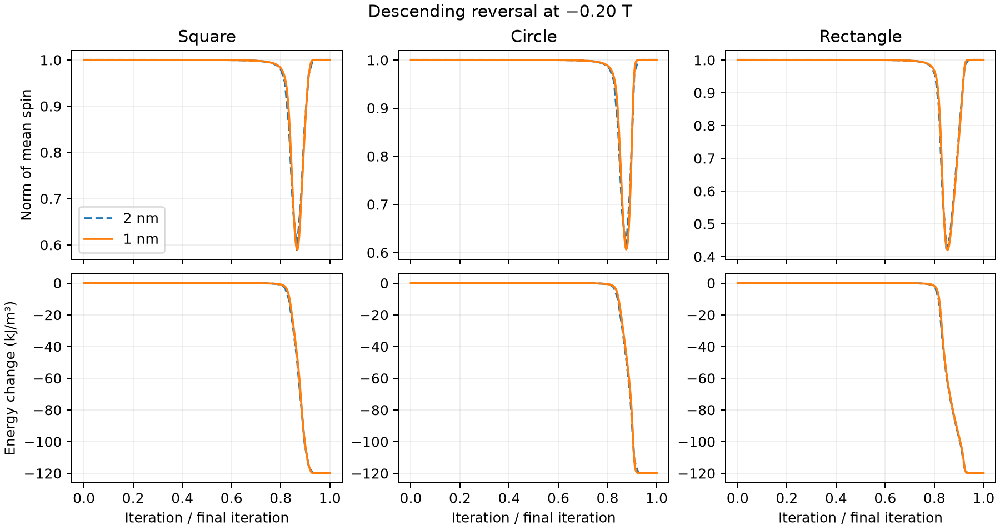

# 下周汇报材料 · 11 月 20 日晚更新

三形状两网格全回线已完成。两种网格共 12 条逐支验证中已完成 10 条，长方形 1 nm 两支仍在验证。三种形状共享 180–185 mT 翻转区间的结论目前覆盖 2 nm 全部三种形状，以及 1 nm 的方形、圆形。长方形 1 nm 的 5 mT 临界点正在补算。

建议汇报将本节置于磁滞回线图之后。先用静态场表解释长方形较小的全片平均 Nz，再用既有中心反向区快照和两网格同场点轨迹说明局部翻转。以下数字可直接用于讲稿。

## 为什么长方形的平均退磁因子较低，翻转场仍落在相近区间？

在 2 nm 网格上，三种形状两支的翻转场绝对值均落入 180–185 mT。要解释这个观察，需要区分两个空间尺度。体积平均退磁因子描述整片薄膜在均匀磁化时的退磁能。翻转始于局部，中心磁化所处的退磁场与全片平均场有明显差别。

下表直接取自 1 nm 网格、均匀固定在 +z 方向的三个原始退磁场文件。定义局部系数为 −Hd,z/Ms。模型的交换长度 √[2A/(μ₀Ms²)] 为 9.403 nm。中心点取最靠近几何轴的四个面内网格柱，核心取半径一个交换长度的圆盘，边缘带取单元中心距侧边界不超过一个交换长度的区域。所有均值覆盖完整 4 nm 厚度，只计磁性单元。

| 形状 | 全片 Nz | 中心点 Nz / μ₀Hd,z (mT) | 核心 Nz / μ₀Hd,z (mT) | 边缘带 Nz / μ₀Hd,z (mT) | 边缘带体积分数 |
|---|---:|---:|---:|---:|---:|
| 方形 | 0.940862 | 0.981999 / −370.205 | 0.981950 / −370.186 | 0.818095 / −308.414 | 17.19% |
| 圆形 | 0.944291 | 0.982280 / −370.311 | 0.982235 / −370.294 | 0.821319 / −309.630 | 15.99% |
| 长方形 | 0.929169 | 0.973775 / −367.105 | 0.973551 / −367.020 | 0.819260 / −308.854 | 21.69% |

长方形有更多磁性体积处于退磁场较弱的边缘带。按“边缘带＋其余区域”实际加权，长方形为 0.2169×0.81926＋0.7831×0.95961 ≈ 0.92917，圆形为 0.1599×0.82132＋0.8401×0.96770 ≈ 0.94429。长方形内部均值也偏低，边缘占比和内部场强共同拉低了全片均值。

4 nm 的厚度远小于最窄的 100 nm 短轴。三种形状核心区的反向退磁场强度均接近 μ₀Ms = 377.0 mT，长方形与圆形的核心场强相差 **3.27 mT**。同一对形状的全片平均场强相差 **5.70 mT**。将单轴各向异性场 B_K = 2Ku/Ms = 533.33 mT 与核心的轴向退磁场相加，得到方形 163.15、圆形 163.04、长方形 166.31 mT。这组数给出均匀 +z 态的局部轴向场尺度。实际失稳还取决于横向偏转引起的退磁场响应、交换作用和有限尺寸允许的空间模式。局部场尺度接近，与翻转场落入同一宽 5 mT 的分辨区间相容；直接用上述差值预测翻转场会低估其绝对值。

**成核位置有独立的空间证据。** 在 −0.20 T 的 2 nm 下降支快照中，首次观测到 mz < 0 的单元都在中心附近。以几何中心为原点，方形反向区域的 x、y 范围均为 ±23 nm，圆形均为 ±21 nm，长方形为 x = ±7 nm、y = ±3 nm。每 50 步取样，因此这些范围描述首次捕捉到的反向区域。均匀 +z 静态场、中心先翻转的快照和随后扩展的磁化图共同支持中心成核解释。

**两网格的翻转过程。** 对同一下降支、同一 −0.20 T 场点，直接读取原始 ODT，每 100 步及停止时取样。表中步数是数值弛豫迭代数。最小模长先对单位磁化矢量做体积平均，再取模长。磁矩若始终同向旋转，此量应接近 1。

| 形状 | 最小平均磁化模长，2 / 1 nm | 最小值所在迭代，2 / 1 nm | 停止迭代，2 / 1 nm |
|---|---:|---:|---:|
| 方形 | 0.5887 / 0.5895 | 5400 / 25100 | 6237 / 28903 |
| 圆形 | 0.6051 / 0.6065 | 5300 / 24500 | 6051 / 27975 |
| 长方形 | 0.4242 / 0.4200 | 5700 / 26500 | 6715 / 31032 |

六条轨迹的总能量在所有相邻采样点间均未上升。原始磁化文件确认，翻转前一场点的平均 mz 均大于 +0.999999，翻转终态均小于 −0.999999。长方形在两种网格上都表现出最强的磁矩方向抵消。1 nm 数据已能确认三种形状均经历非均匀翻转，本项无需新增快照。精确成核位置的直接观测来自 2 nm 快照，1 nm 标量轨迹本身没有空间坐标。

