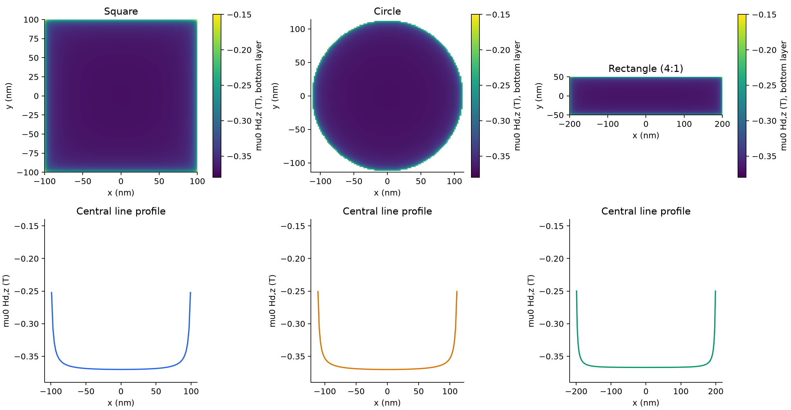
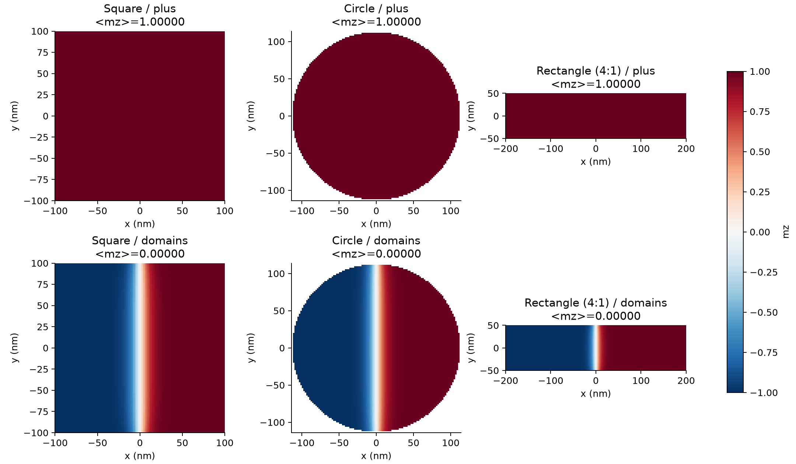
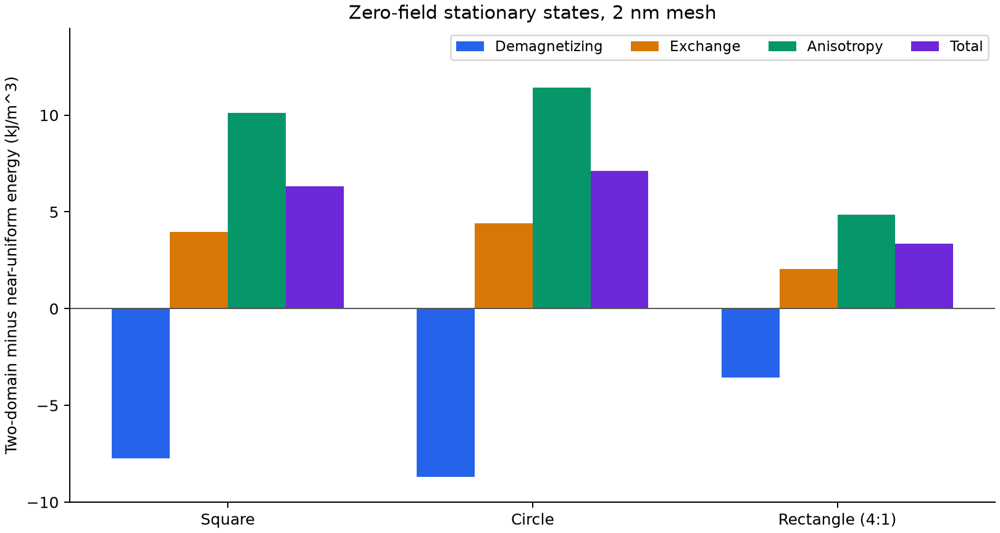
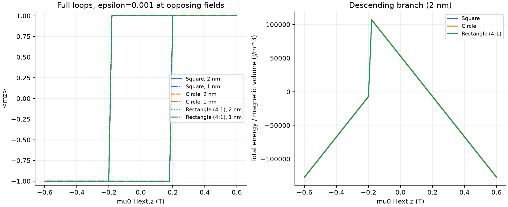
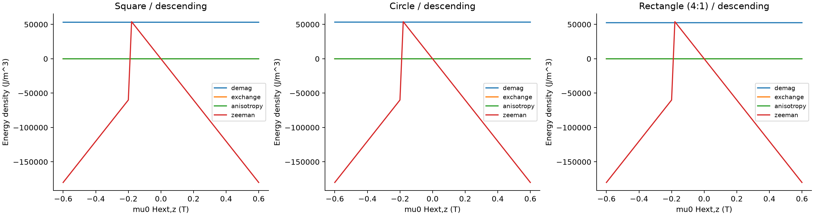
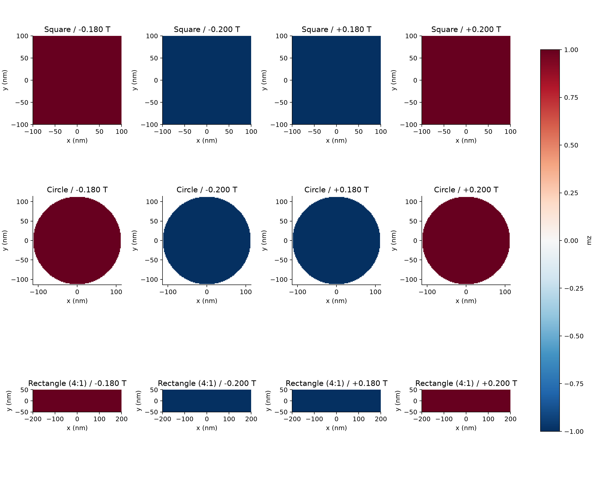
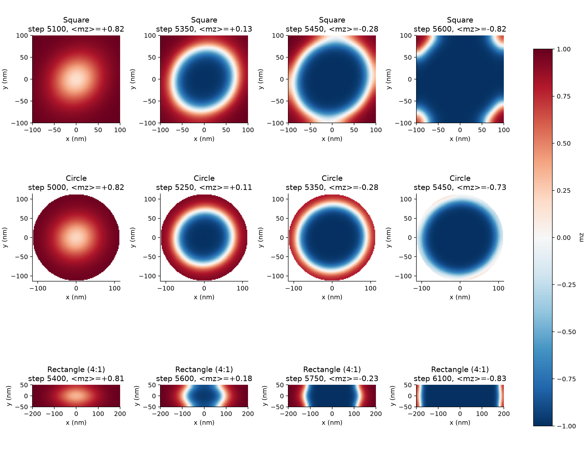

# 仿真结果与验证进展

已分析算例目录：426（包括诊断和聚合路径目录，不能直接当作独立实验数量）。
状态：阶段性结果，最终数值验收尚未完成。

正式磁滞采用统一 ε=10⁻³ 横向扰动协议，仅在外场与上一态平均磁化反向的场点施加。原始无扰动曲线留作驻点诊断，不用于下面的矫顽场统计。详见 [实施记录](DECISIONS.md)。

## 固定均匀磁化的退磁因子

| 形状 | 网格/nm | Nx | Ny | Nz | 实际面积/nm² |
|---|---:|---:|---:|---:|---:|
| square | 2 | 0.029568913 | 0.029568913 | 0.940862174 | 40000 |
| square | 1 | 0.029568913 | 0.029568913 | 0.940862174 | 40000 |
| circle | 2 | 0.028018126 | 0.028018126 | 0.943963748 | 39936 |
| circle | 1 | 0.027854473 | 0.027854473 | 0.944291053 | 40000 |
| rectangle | 2 | 0.013690285 | 0.057140628 | 0.929169087 | 40000 |
| rectangle | 1 | 0.013690285 | 0.057140628 | 0.929169087 | 40000 |

## 多初态的能量竞争

| 形状 | 近单畴能量密度/J·m⁻³ | 双畴能量密度/J·m⁻³ | 双畴减近单畴/J·m⁻³ | 双畴平均绝对 mz |
|---|---:|---:|---:|---:|
| square | 53203.64 | 59534.87 | 6331.24 | 0.91275 |
| circle | 53379.11 | 60485.45 | 7106.34 | 0.90154 |
| rectangle | 52542.19 | 55896.67 | 3354.49 | 0.95795 |

在当前测试的零场初态中，三种形状的近单畴态均比双畴驻态能量低。分畴降低退磁能，但增加的交换能与各向异性能更大。双畴态的平均 mz 接近零，而平均绝对 mz 仍接近 1，说明净磁化抵消来自上下畴，并非整体面内磁化。该比较仅覆盖本次初态集合。

## 磁滞指标

| 形状 | 网格/nm | Mr+/Ms | Mr−/Ms | 两支粗场步翻转区间/T |
|---|---:|---:|---:|---|
| square | 2 | 0.999999847 | -0.999999847 | [[-0.18, -0.2], [0.18, 0.2]] |
| square | 1 | 0.999999854 | -0.999999854 | [[-0.18, -0.2], [0.18, 0.2]] |
| circle | 2 | 0.999999861 | -0.999999861 | [[-0.18, -0.2], [0.18, 0.2]] |
| circle | 1 | 0.999999867 | -0.999999867 | [[-0.18, -0.2], [0.18, 0.2]] |
| rectangle | 2 | 0.999999808 | -0.999999808 | [[-0.18, -0.2], [0.18, 0.2]] |
| rectangle | 1 | 0.999999817 | -0.999999817 | [[-0.18, -0.2], [0.18, 0.2]] |

三种形状在当前零温、无缺陷模型及相同场历史下，撤场后的面外剩磁均接近饱和。末尾小数的微小差别不用于形状优劣排序；翻转场比较使用下面的区间与数值复核。

### 加密后的矫顽场

| 形状 | 网格/nm | 负支翻转夹逼/T | 正支翻转夹逼/T | 矫顽场估计/T | 矫顽场夹逼/T |
|---|---:|---|---|---:|---|
| square | 2 | [-0.1850, -0.1800] | [0.1800, 0.1850] | 0.1825 | [0.1800, 0.1850] |
| square | 1 | [-0.1850, -0.1800] | [0.1800, 0.1850] | 0.1825 | [0.1800, 0.1850] |
| circle | 2 | [-0.1850, -0.1800] | [0.1800, 0.1850] | 0.1825 | [0.1800, 0.1850] |
| rectangle | 2 | [-0.1850, -0.1800] | [0.1800, 0.1850] | 0.1825 | [0.1800, 0.1850] |

矫顽场幅值定义为 (bc+−bc−)/2，采用两支翻转区间传播得到夹逼范围。它表示离散场步下的区间，不是重复抽样的统计置信区间。最终形状排序还需通过网格与协议检查。

## 代表翻转过程

对每种形状的下降支首个翻转场点重放，保持原始初态、外场和求解参数，仅增加每 50 个接受步保存一次磁化的输出。图中标注求解器迭代步，不作为物理翻转时间。

| 形状 | 外场/T | 保存快照数 | 最小平均磁化矢量模长 | 与原终态最大磁化分量差 |
|---|---:|---:|---:|---:|
| square | -0.200 | 126 | 0.58866 | 0 |
| circle | -0.200 | 123 | 0.60507 | 0 |
| rectangle | -0.200 | 136 | 0.42423 | 0 |

平均磁化矢量模长明显小于 1 表明中间过程存在空间不均匀，不能仅凭翻转前后均为近单畴态就认定为一致旋转。具体空间变化见下方快照；这些是给定外场与初始化协议下的零温数值弛豫过程。
快照显示底层网格的 mz，平均量在整个磁性体积内计算。
在本次 −0.20 T 重放快照中，方形和圆形先在中心形成反向区域，再向外扩展；长方形形成中央反向带并向两端推进。该空间过程的描述限定于这组参数、网格和场点，不把关闭进动的迭代快慢解释为物理翻转速度。

## 验收记录

未完成项目：['两种网格翻转区场步/阈值与扰动检验']。
未通过检查：当前已执行检查中无。
细化场区间、扰动结果和每项布尔检查见 [results.json](results.json)。
每个算例的 config.json 保存初态、前驱状态校验和、外场路径和输入校验和；summary.json 保存每个场点的磁性体积平均、能量和收敛记录。

## 图表与解释范围

所有参数均为教学模型，零温、无缺陷、关闭进动。多初态结果是所测试初态的驻态，不是基态证明；磁滞中的零场点才用于报告剩磁。关闭进动的积分时间不代表物理翻转时间。微磁学结果不直接证明 QAH 或量子化霍尔电导。
