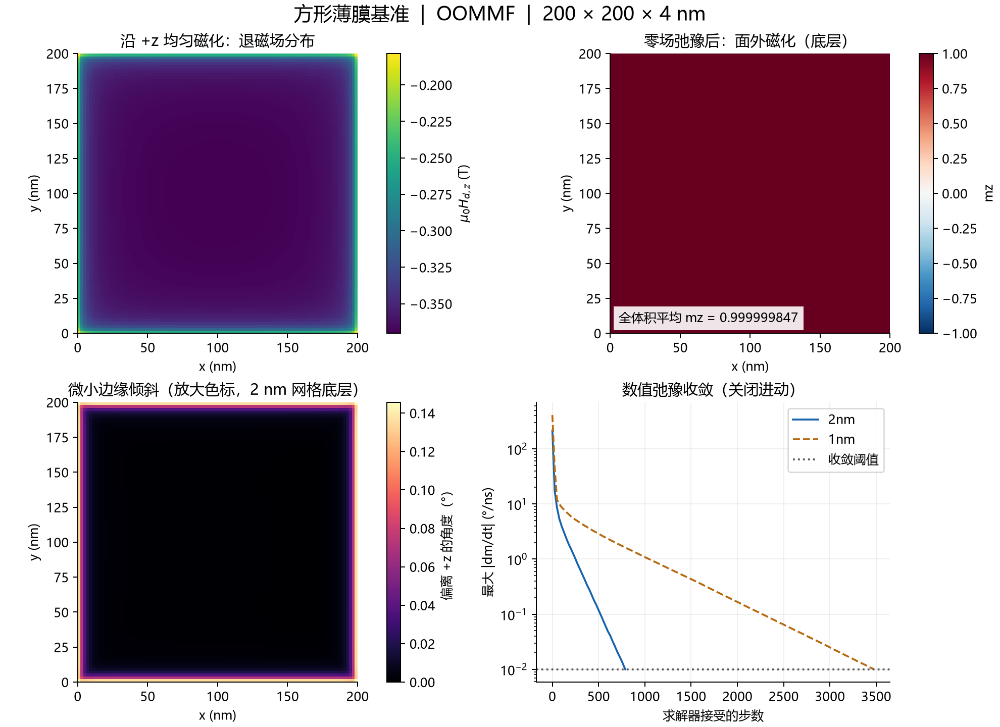

# 方形薄膜基准模拟

2026-11-08 已在本机用 **OOMMF 2.0b0** 完成首个薄膜算例。固定均匀磁化的退磁因子校验、零场弛豫、2 nm→1 nm 网格复核以及收敛条件收紧检查均通过。参数沿用项目教学模型，不对应已经核实的真实 QAH 材料。

## 电脑环境与求解器选择

| 项目 | 实测配置 |
|---|---|
| 系统 | Windows 11，build 26200，64 位 |
| CPU | Intel Core Ultra 9 275HX，24 个逻辑处理器 |
| 内存 | 约 32 GB（系统可用总量 31.43 GiB） |
| GPU | NVIDIA GeForce RTX 5060 Laptop GPU，8151 MiB 显存 |
| NVIDIA 驱动与计算能力 | 621.01；compute capability 12.0 |
| Python | 3.14.7；项目独立环境 `.venv` |
| WSL / Fidimag | WSL 未安装；原 Python 中未发现 Fidimag |
| 本次求解器 | OOMMF 2.0b0，8 个 CPU 线程 |

MuMax3 官方 Windows CUDA 12.9 构建覆盖这张显卡的计算能力，实际 CUDA 初始化也成功。但 3.12 构建的卷积自检失败；均匀薄膜诊断值在已测试精度下也未通过本项目的误差标准，因此本次改用 OOMMF。不能据此认定显卡硬件故障。完整诊断见 [诊断记录](diagnostics/README.md)。

OOMMF 来自 [NIST 官方下载](https://math.nist.gov/oommf/software-20.html)，运行库使用电脑已有的 Git for Windows Tcl 8.6.18。按 [NIST 的 DLL 命名兼容说明](https://math.nist.gov/oommf/software-20.html)，仅在项目 `.tools/oommf-runtime` 中创建兼容名称的 DLL 副本。求解器位于 `.tools`；未修改系统 PATH、显卡驱动或已有 Python 环境。下载地址、版本及 SHA256 记录在 [environment.json](environment.json)。

## 模型与计算流程

| 参数 | 数值 |
|---|---|
| 尺寸 | 200×200×4 nm |
| 网格 | 2×2×2 nm，100×100×2；复核为 1×1×1 nm，200×200×4 |
| 饱和磁化强度 Ms | 3×10⁵ A/m |
| 交换刚度 A | 5×10⁻¹² J/m |
| 本征单轴各向异性 Ku | 8×10⁴ J/m³，易轴 z |
| 阻尼 α / Gilbert γ | 0.5 / 2.21×10⁵ m/(A·s) |
| 外场与温度 | 零外场、零温；无缺陷、无 DMI |
| 边界 | 非周期的有限长方体 |
| 弛豫初态 | (0.01, 0, 1) 归一化，略偏离 +z |
| 求解 | RKF54；关闭进动，仅作数值弛豫 |
| 收敛标准 | 最大磁化变化率 ≤0.01 °/ns；2 nm 额外收紧到 0.005 °/ns |

1. 固定所有磁矩，分别取 x、y、z 均匀方向，只计算退磁场与能量。三组最终迭代数均为 0，没有发生弛豫。
2. 用磁性体积内平均场 `Ni = −〈Hd,i〉/Ms` 与能量 `Ni = 2Ed/(μ0 Ms² V)` 交叉核对，并与项目已有解析脚本比较。
3. 解除固定，加入交换、各向异性及零外场，从略倾斜初态弛豫。保存磁化、退磁场、总有效场和能量表。
4. 网格缩小到 1 nm 完整复算；另用更严格的停止条件复算 2 nm 弛豫。

OOMMF 的场文件单位是 A/m；图中退磁场乘 μ0 后以 T 表示。关闭进动后的积分时间不是可报告的物理翻转时间。

## 已验证的结果

| 量 | 解析值 | OOMMF，2 nm 网格 |
|---|---:|---:|
| Nx | 0.029568912838 | 0.029568912838 |
| Ny | 0.029568912838 | 0.029568912838 |
| Nz | 0.940862174324 | 0.940862174324 |

两种网格、三个方向的最大退磁因子绝对误差约 **2.8×10⁻¹⁵**，通过本项目 `10⁻⁴` 的验收标准；场法与能量法一致，Nx+Ny+Nz≈1，Nx≈Ny。这是均匀长方体基准的数值一致性，不代表一般磁畴模拟也有如此小的物理误差。

| 零场弛豫指标 | 2 nm | 1 nm |
|---|---:|---:|
| 平均 mz | 0.999999846817 | 0.999999853920 |
| 最小局部 mz | 0.999996770608 | 0.999993679455 |
| 反向磁化单元比例 | 0 | 0 |
| 最大偏离 +z 角度 | 0.14561° | 0.20371° |
| 最大磁化变化率 | 0.00998748 °/ns | 0.00998110 °/ns |
| 总能量 | 8.512581809×10⁻¹⁸ J | 8.512564403×10⁻¹⁸ J |
| 接受的迭代步数 | 788 | 3476 |

网格细化后的平均 mz 变化约 **7.1×10⁻⁹**，总能量相对变化约 **2.04×10⁻⁶（0.000204%）**。将 2 nm 的停止阈值减半，平均 mz 变化约 3.36×10⁻¹¹，总能量相对变化约 3.42×10⁻¹¹。磁化模长最大误差约 3.3×10⁻¹⁶。

对保存的磁化与总有效场独立代入关闭进动的 LLG 右端，得到的最大变化率与求解器报告一致。另核对各能量项之和、退磁能的场积分、记录点能量下降及是否撞到迭代上限；共 50 项检查通过，详见 [summary.json](summary.json) 和 [validation.log](validation.log)。

平均磁化和总能量对本次网格变化不敏感；局部边缘最大倾角仍改变约 **0.058°**，后续若以边缘成核或局部倾角作结论，需要进一步检验空间分辨率。



这说明：在这组教学参数下，略偏离面外的初态能弛豫到接近 +z 的静态状态，边缘存在微小倾斜。它不是基态证明；尚未做多初态比较、外场饱和后撤场或磁滞。因此这里不报告剩磁、矫顽场、热稳定性或 QAH 电导。

## 文件与复现

- [square.mif](square.mif)：共同的 OOMMF 输入，参数控制网格、固定方向和停止条件。
- [run_baseline.py](run_baseline.py)：运行全部 9 组计算，已有完整结果会保留，输入不匹配或输出不完整时拒绝覆盖。
- [analyze.py](analyze.py)：读取原始场文件和能量表，独立校验并生成图片、CSV、JSON。
- `oommf_*`：原始 `.omf` 磁化、`.ohf` 场、`.odt` 能量与收敛记录；包含输入快照。批量运行的 7 组还保存命令、耗时及日志；首次单独运行的 2 组启动信息在 `.tools/oommf20b0/oommf/boxsi.errors` 中。
- [requirements.txt](requirements.txt)：当前分析环境的确切依赖版本。

从项目根目录运行已有结果的校验：

```powershell
.\.venv\Scripts\python.exe simulations/baseline/analyze.py
```

完整重算到新目录，保留这次结果：

```powershell
.\.venv\Scripts\python.exe simulations/baseline/run_baseline.py --output-root simulations/baseline/repeat_01
.\.venv\Scripts\python.exe simulations/baseline/analyze.py --results-root simulations/baseline/repeat_01
```

只跑一个新算例可加 `--case 2nm_relax`；完整分析需要全部 9 组。OOMMF 的本地通信服务需能在本机启动。在本机普通终端运行即可；受限执行环境可能需要允许本地进程通信。程序不打开图形窗口。

换电脑时需从上述 NIST 地址取得同版 OOMMF，准备兼容的 Tcl 8.6，并在运行脚本中调整 Tcl 路径。MuMax3 诊断文件不属于正式复现流程。

## 下一步

先补充面内、扰动和反向/分畴初态，以及外场饱和后撤场；然后在相同面积、厚度和材料参数下比较方形、圆形与长方形。磁滞扫描和翻转区间的网格、场步检查另行开展。
