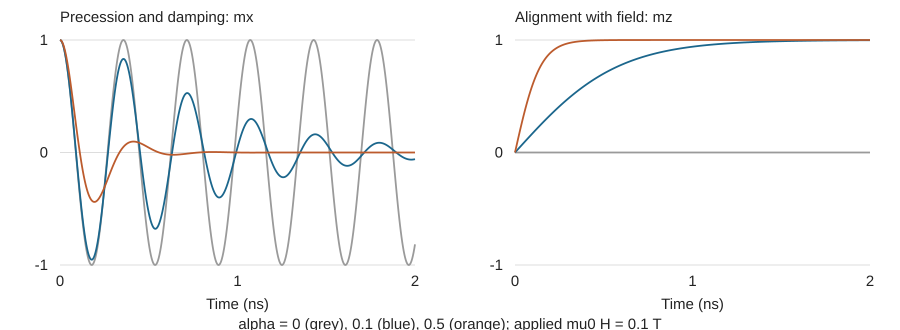

# Fidimag 材料参数与 LLG 方程学习指南

从核心方程到薄膜退磁场计算

中文节译与学习补充 · 2026 年 10 月 19 日

## 1 阅读目标与模型层次

微磁学软件的核心工作是：**根据材料参数和当前磁化分布计算有效场，再用 LLG 方程更新磁化方向，重复直到指定时刻或满足弛豫条件。** 材料参数决定能量竞争；LLG 方程决定磁化怎样响应这些竞争。

本文围绕 Fidimag 官方 Core equations 页中材料描述、相关相互作用和 LLG 两个模型层次整理。标为“中文节译”的段落对应原网页；“学习补充”给出单位校正、推导和计算方法。方程统一了符号，原文存在的问题在第 12 节集中列出。主要来源见 [1]，软件接口核对见 [2–5]。

### 中文节译 原子自旋模型

Fidimag 可以用离散自旋形式或材料的连续近似进行模拟，自旋在半经典层面描述。原子模型把材料表示为磁矩构成的晶格：

$$\boldsymbol\mu_i=\mu_s\mathbf S_i,\qquad |\mathbf S_i|=1,\qquad \mu_s=g\mu_B S.$$

这里，单位向量 $\mathbf S_i$ 表示方向；$g$ 为朗德因子，$\mu_B$ 为玻尔磁子，$S$ 表示平均自旋大小。晶格排列由材料晶体结构决定；原页列出二维或三维方格及二维六角格。磁矩之间的相互作用用海森堡形式描述。

### 中文节译 微磁学模型

连续近似中，材料被离散为规则网格，用有限差分计算相互作用。研究变量变成随位置变化的磁化场；各网格点有一个磁化向量。在原页所讨论的零温模型中，以饱和磁化强度描述其大小：

$$\mathbf M(\mathbf r,t)=M_s\mathbf m(\mathbf r,t),\qquad |\mathbf m|=1,\qquad [M_s]=\mathrm{A/m}.$$

**学习补充**：原子模型的一个变量对应晶格磁矩；微磁学的一个网格单元通常代表许多原子。网格单元的等效磁矩为 $\boldsymbol\mu_{\rm cell}=M_s\Delta V\mathbf m$，不能把一个原子的磁矩直接除以任意粗网格体积来获得真实材料的 $M_s$。向量 $\mathbf S_i$ 与上式标量 $S$ 也不是同一个量。

**本项目的切入点**：研究铁磁薄膜的形状、退磁场和磁畴，先采用微磁学模型。它能研究 QAH 相关的磁性条件，但本身不求电子输运或量子化霍尔电导。

阅读顺序：第 2–4 节掌握参数与能量，第 5–7 节理解 LLG，第 8–11 节动手计算，第 12–14 节自查与查源。

<!-- PAGE -->

## 2 材料参数和单位对照

**学习补充**：下表把原页分散在不同方程中的参数集中起来。前三类是材料性质；几何、外场和数值设置需要另行指定。

| 符号与英文 | 物理含义 | SI 单位 | 对计算的作用 |
|---|---|---|---|
| $M_s$ saturation magnetisation | 饱和磁化强度 | A/m | 给出局域磁化大小，影响退磁场和各有效场尺度 |
| $A$ exchange stiffness | 交换刚度 | J/m | 惩罚相邻位置磁化方向的变化 |
| $K_u$ uniaxial anisotropy | 单轴各向异性能量密度系数 | J/m³ | 与易轴方向一起规定磁化偏好 |
| $D_a$ continuum DMI constant | 连续模型 DMI 系数 | J/m² | 决定手性磁结构的能量贡献 |
| $\alpha$ Gilbert damping | 吉尔伯特阻尼 | 无量纲 | 控制耗散和弛豫过程 |
| $\gamma_H$ gyromagnetic ratio | 与 H 场配套的陀螺磁比大小 | m/(A·s) | 给出微磁学动力学时间尺度 |
| $\mu_s$ magnetic moment | 单个晶格磁矩大小 | J/T 或 A·m² | 原子模型中把能量导数换算成有效场 |
| $J,\mathcal K_u,\mathbf D_{ij}$ | 原子交换、各向异性及 DMI 能量参数 | J | 不能与连续模型参数直接互换 |

**能量与能量密度不同**：$K_u$ 的单位为 J/m³，单元各向异性能量的数量级为 $K_u\Delta V$；$A$ 的单位为 J/m，必须乘空间梯度的平方再对体积积分。原页将 $\mathcal K_u$ 写为 eV；放进 SI 公式前，要按 $1\ \mathrm{eV}=1.602176634\times10^{-19}\ \mathrm J$ 换算。原子程序接口的实际输入单位还需查对应类。

### 必须分开的场量

$$[\mathbf H]=\mathrm{A/m},\quad [\mathbf B]=\mathrm T,\quad \mathbf B=\mu_0(\mathbf H+\mathbf M).$$

实验和软件中常用“$\mu_0H_{\rm ext}=100\ \mathrm{mT}$”报告外场。它等价于 $H_{\rm ext}\approx7.958\times10^4\ \mathrm{A/m}$。**Fidimag 的 micro.Zeeman 输入是 A/m**，因此应输入约 79577，而不是 0.1 [3]。

这里用 $\mu_0\approx4\pi\times10^{-7}\ \mathrm{H/m}$，与本文示例及 Fidimag 的常量约定一致。注意：$\mu_0H_{\rm eff}$ 是 LLG 中的场尺度，不代表材料内完整的麦克斯韦磁感应强度 $\mathbf B$。

### 还要提供哪些输入

几何尺寸和边界条件、网格大小、初始磁化、外场序列、易轴方向、是否加入退磁和 DMI，以及积分误差容限和停止标准，都会影响结果。**网格尺寸是数值分辨率，不是材料参数。** $\alpha$ 虽是物性参数，也常在单纯求平衡时被人为调大；此时要记录它用于数值弛豫。

<!-- PAGE -->

## 3 交换和各向异性的中文节译

原页将总磁能写为交换、各向异性、偶极、DMI 和塞曼能之和 [1]。软件中只有明确添加的能量项才参与有效场计算。

### 中文节译 交换作用

最近邻海森堡交换能为下式；每对自旋只求和一次：

$$\mathcal H_{\rm ex}=-J\sum_{\langle i,j\rangle}\mathbf S_i\cdot\mathbf S_j,\qquad
\mathbf B_{i,\rm ex}^{\rm eff}=\frac{J}{\mu_s}\sum_{j\in\mathrm{nn}(i)}\mathbf S_j.$$

连续极限中的交换能及其 H 制有效场为：

$$E_{\rm ex}=\int_V A\sum_{q=x,y,z}|\partial_q\mathbf m|^2\,\mathrm dV,\qquad
\mathbf H_{\rm ex}=\frac{2A}{\mu_0M_s}\nabla^2\mathbf m.$$

**学习补充**：$J>0$ 时邻近磁矩平行降低能量；$A>0$ 时空间变化越剧烈，交换能越高。$A$ 是**交换刚度**，原文称其为 anisotropy constant 是术语笔误。上述连续场公式假定均匀 $A,M_s$；材料界面应按软件的离散化处理。

原页的 $J_x=2A\Delta y\Delta z/\Delta x$ 表示有限差分单元间的**等效交换耦合能量**，并不是有效场。简单立方、最近邻且每键只计一次时，有 $J=2Aa$；它依赖模型约定，不能视为任意晶体的通用参数换算。

### 中文节译 单轴各向异性

设单位向量 $\hat{\mathbf u}$ 为轴方向。原子模型中：

$$\mathcal H_{\rm an}=-\mathcal K_u\sum_i(\mathbf S_i\cdot\hat{\mathbf u})^2,\qquad
\mathbf B_{i,\rm an}^{\rm eff}=\frac{2\mathcal K_u}{\mu_s}(\mathbf S_i\cdot\hat{\mathbf u})\hat{\mathbf u}.$$

微磁学模型中：

$$E_{\rm an}=\int_VK_u[1-(\mathbf m\cdot\hat{\mathbf u})^2],\mathrm dV,\qquad
\mathbf H_{\rm an}=\frac{2K_u}{\mu_0M_s}(\mathbf m\cdot\hat{\mathbf u})\hat{\mathbf u}.$$

**学习补充**：$K_u>0$ 时，平行或反平行于轴都具有最低能量，称为易轴；$K_u<0$ 时偏好垂直于轴的平面。写成 $-K_u(\mathbf m\cdot\hat{\mathbf u})^2$ 只差一个与方向无关的常数，因此给出相同转矩。

原页还列出立方各向异性：$\mathcal H_c=\mathcal K_c\sum_i(S_{ix}^4+S_{iy}^4+S_{iz}^4)$。单位自旋满足 $S_x^4+S_y^4+S_z^4=1-2(S_x^2S_y^2+S_y^2S_z^2+S_z^2S_x^2)$，所以原页两种写法**相差常数**，对方向动力学等价。本文薄膜入门模型只用单轴项。

<!-- PAGE -->

## 4 偶极 DMI 与外场的中文节译

### 中文节译 偶极作用

设 $\mathbf r_{ij}$ 从晶格点 i 指向 j，$r_{ij}=|\mathbf r_{ij}|$。原页给出的偶极能可写为：

$$\mathcal H_d=\frac{\mu_0\mu_s^2}{4\pi}\sum_{i<j}
\frac{\mathbf S_i\cdot\mathbf S_j-3(\mathbf S_i\cdot\hat{\mathbf r}_{ij})(\mathbf S_j\cdot\hat{\mathbf r}_{ij})}{r_{ij}^3}.$$

$$\mathbf B_{i,d}^{\rm eff}=\frac{\mu_0\mu_s}{4\pi}\sum_{j\ne i}
\frac{3\hat{\mathbf r}_{ij}(\mathbf S_j\cdot\hat{\mathbf r}_{ij})-\mathbf S_j}{r_{ij}^3}.$$

**学习补充 微磁学退磁场**：连续模型通过静磁问题得到非局域退磁场，开边界时还要包含样品外部空间的影响：

$$\nabla\times\mathbf H_d=0,\quad\nabla\cdot(\mathbf H_d+\mathbf M)=0,\qquad
E_d=-\frac{\mu_0}{2}\int_V\mathbf M\cdot\mathbf H_d\,\mathrm dV.$$

因子 $1/2$ 避免自相互作用重复计数。交换场主要看近邻，退磁场则依赖整个样品的磁化与形状；改变轮廓、厚度或周期边界都会改变它。Fidimag 薄膜例子使用 `Demag()`，不能用一个原子点偶极公式代替整个单元的退磁计算。

### 中文节译 DMI

DMI 是自旋之间反对称的各向异性交换耦合：

$$\mathcal H_{\rm DMI}=\sum_{\langle i,j\rangle}\mathbf D_{ij}\cdot(\mathbf S_i\times\mathbf S_j),\qquad
\mathbf D_{ij}=-\mathbf D_{ji}.$$

连续体相 DMI 的一种约定为：

$$E_{\rm DMI}=\int_V D_a\mathbf m\cdot(\nabla\times\mathbf m)\,\mathrm dV,\qquad
\mathbf H_{\rm DMI}=-\frac{2D_a}{\mu_0M_s}\nabla\times\mathbf m.$$

原页还给出界面 DMI 和 $D_{2d}$ 对称性形式；它们的结构及符号约定不同。原页简单晶格映射中，体相为 $D_a=-D/a^2$，界面为 $D_a=D/a^2$。**不能只复制一个 D 值而不说明模型、单位和手性约定。** 初期退磁场比较可设 DMI 为零；研究特定材料时再根据证据加入。

### 中文节译 塞曼能并统一单位

外场与磁矩耦合降低沿场方向的能量。原子模型使用 T 制场；连续模型使用 H 制场时分别为：

$$\mathcal H_Z=-\sum_i\mu_s\mathbf B_{\rm ext}\cdot\mathbf S_i,\qquad
E_Z=-\mu_0\int_VM_s\mathbf H_{\rm ext}\cdot\mathbf m\,\mathrm dV.$$

原页原子式将这里的 $\mathbf B_{\rm ext}$ 记作 H，阅读时要按能量量纲识别，不能直接沿用到微磁学的 `Zeeman` 输入。

<!-- PAGE -->

## 5 LLG 方程的中文节译与统一记号

### 中文节译 原子模型

离散理论中，磁矩方向随时间的演化由 Landau–Lifshitz–Gilbert 方程支配。有效场由磁系统的哈密顿量对自旋方向的导数给出 [1]：

$$\frac{\mathrm d\mathbf S_i}{\mathrm dt}=-\frac{\gamma_B}{1+\alpha^2}
\left[\mathbf S_i\times\mathbf B_i^{\rm eff}+\alpha\mathbf S_i\times(\mathbf S_i\times\mathbf B_i^{\rm eff})\right],$$

$$\mathbf B_i^{\rm eff}=-\frac{1}{\mu_s}\frac{\partial\mathcal H}{\partial\mathbf S_i},\qquad
\gamma_B\approx1.76\times10^{11}\ \mathrm{rad/(s\cdot T)}.$$

这里 $\mu_s=|\boldsymbol\mu_i|$；$\alpha$ 是 Gilbert 阻尼常数，$\gamma_B$ 设定时间尺度。原页用 H 表示上述有效场，但其单位由 J/(J/T) 可知是 T；本文改用 $\mathbf B^{\rm eff}$ 标记其单位，避免混淆。

### 中文节译 微磁学模型

微磁学极限的方程结构相同。若有效场使用 A/m，则采用：

$$\frac{\partial\mathbf m}{\partial t}=-\frac{\gamma_H}{1+\alpha^2}
\left[\mathbf m\times\mathbf H_{\rm eff}+\alpha\mathbf m\times(\mathbf m\times\mathbf H_{\rm eff})\right],$$

$$\mathbf H_{\rm eff}(\mathbf r)=-\frac{1}{\mu_0M_s}\frac{\delta E}{\delta\mathbf m(\mathbf r)},\qquad
\gamma_H=\mu_0\gamma_B\approx2.21\times10^5\ \mathrm{m/(A\cdot s)}.$$

**学习补充**：这里采用总能量的**泛函导数**；$\delta E/\delta\mathbf m$ 的单位为 J/m³。若对离散总能量求普通偏导，就要显式除以单元体积：

$$\mathbf H_{{\rm eff},i}=-\frac{1}{\mu_0M_{s,i}\Delta V_i}\frac{\partial E}{\partial\mathbf m_i}.$$

原页把这两种写法压缩为一个偏导式。实际编程时若漏掉 $\Delta V_i$，就会得到错误的量纲和数值。

### 两套单位只能成对使用

| 有效场的输入单位 | 配套的陀螺磁比 | 场乘陀螺磁比 |
|---|---|---|
| A/m | $\gamma_H\approx2.21\times10^5$ m/(A·s) | 角速度量级 s⁻¹ |
| T | $\gamma_B\approx1.76\times10^{11}$ rad/(s·T) | 角速度量级 rad/s |

本文取正的陀螺磁比大小，把进动方向的负号显式写在方程中。原页的 Hz·T⁻¹ 单位标注不适合 $2.21\times10^5$ 这个 H 制数值。原页写 $0\le\alpha\le1$；这是其常用参数范围，LLG 数学形式并不要求 $\alpha$ 必须小于等于 1。

<!-- PAGE -->

## 6 怎样理解进动 阻尼和能量降低

以下是学习补充，用于解释第 5 节的方程，而不是原网页逐句翻译。

### 第一个叉乘给出进动

$-\mathbf m\times\mathbf H_{\rm eff}$ 同时垂直于磁化与有效场。因此，磁化方向围绕有效场旋转，称为**进动**。在恒定均匀场、没有其他能量项且 $\alpha=0$ 时，磁化与场的夹角保持不变，不会自动沿场对齐。

### 双重叉乘给出耗散

$$\mathbf m\times(\mathbf m\times\mathbf H)
=(\mathbf m\cdot\mathbf H)\mathbf m-\mathbf H.$$

因为方程前有负号，阻尼项推动磁化朝有效场的切向分量转动。在单磁矩恒场例子中，磁化绕场旋转，同时逐渐靠近场方向。多单元体系的有效场本身也随磁化变化，最终状态可能是非均匀磁畴。

### 为什么不会改变局域磁化长度

$$\frac{\mathrm d}{\mathrm dt}|\mathbf m|^2=2\mathbf m\cdot\frac{\partial\mathbf m}{\partial t}=0.$$

两项都垂直于 $\mathbf m$，所以理想 LLG 保持 $|\mathbf m|=1$，描述方向演化。磁化的空间平均仍然可能下降：例如一半向上、一半向下的磁畴可使平均磁化接近零，但每处的 $M_s$ 并没有消失。普通固定模长 LLG 不描述激光加热导致的纵向磁化幅值衰减。

### 为什么阻尼会降低能量

对时间不显含的能量、固定材料参数、零温且无电流转矩，代入有效场定义可得：

$$\frac{\mathrm dE}{\mathrm dt}=-\frac{\mu_0M_s\gamma_H\alpha}{1+\alpha^2}
\int_V|\mathbf m\times\mathbf H_{\rm eff}|^2\,\mathrm dV\le0.$$

这里展示均匀 $M_s,\alpha$ 情形。进动不改变能量，阻尼耗散能量。若外场随时间改变，外场可以做功，此时总磁能不必单调下降。若纯弛豫能量明显反复上升，应检查误差容限、能量计算及模型设置。

### 因子 1 加阻尼平方从哪里来

Gilbert 隐式形式为 $\dot{\mathbf m}=-\gamma_H\mathbf m\times\mathbf H+\alpha\mathbf m\times\dot{\mathbf m}$。用 $\mathbf m\cdot\dot{\mathbf m}=0$ 和 $\mathbf m\times(\mathbf m\times\dot{\mathbf m})=-\dot{\mathbf m}$ 消去右侧的 $\dot{\mathbf m}$，得到第 5 节显式式子中的 $1/(1+\alpha^2)$。不能在保持其余参数约定不变时随手删掉它。

**平衡条件**：$\mathbf m\times\mathbf H_{\rm eff}=0$ 是驻点条件，不是“已经证明全局能量最低”。完全反向排列也可能转矩为零，却是不稳定驻点。因此需要扰动和不同初态来检查稳定性。

<!-- PAGE -->

## 7 用参数估算薄膜行为和网格尺度

**学习补充**：先估算数量级，再运行软件。以下全部采用教学假设参数，不能当作某种 QAH 材料的实测数据：

$$M_s=3.0\times10^5\ \mathrm{A/m},\quad A=5.0\times10^{-12}\ \mathrm{J/m},\quad
K_u=8.0\times10^4\ \mathrm{J/m^3},\quad\hat{\mathbf u}=\hat{\mathbf z}.$$

### 面外各向异性与退磁的竞争

无限延伸、均匀磁化的薄膜近似有 $N_z\approx1$，$N_x,N_y\approx0$，于是：

$$E_d/V\approx\tfrac12\mu_0M_s^2m_z^2,\qquad
K_{\rm eff}\approx K_u-\tfrac12\mu_0M_s^2.$$

本例的形状能量尺度约 $5.65\times10^4$ J/m³，$K_{\rm eff}\approx2.35\times10^4$ J/m³，品质因子 $Q=2K_u/(\mu_0M_s^2)\approx1.41$。这表示均匀薄膜近似下各向异性足以抵抗面外退磁能的局部倾斜代价，**不保证有限尺寸样品的全局最低能态是单畴**。

对一般均匀磁化形状，比较 z 与 x 方向的系数为 $K_u-\mu_0M_s^2(N_z-N_x)/2$。有限矩形的局部退磁场并不均匀，必须计算完整场。

### 长度尺度

$$\ell_{\rm ex}=\sqrt{\frac{2A}{\mu_0M_s^2}}\approx9.40\ \mathrm{nm},\qquad
\ell_K=\sqrt{\frac{A}{|K_u|}}\approx7.91\ \mathrm{nm}.$$

在简单一维局域各向异性模型中，畴壁参数 $\Delta=\sqrt{A/K_{\rm eff}}\approx14.6$ nm，常用壁宽估算 $\delta\approx\pi\Delta\approx45.9$ nm。完整退磁、DMI、边界和壁型会改变这些估算。

起始网格可选 2 nm，使交换长度和典型磁化变化区有多个单元。随后用 1 nm 网格复算关键结果；网格小于某个长度只是起点，**收敛检查才是可信依据**。厚度方向是否可只用一层，也要结合厚度、层间变化与分层复算决定。

### 场与时间尺度

各向异性场尺度 $\mu_0H_k=2K_u/M_s\approx0.533$ T，退磁场尺度 $\mu_0M_s\approx0.377$ T。二者均是数量级判断，不等于样品的矫顽场。

单磁矩只有恒定 $\mu_0H=0.1$ T，且 $\alpha=0.1$ 时，$\omega=\gamma_HH/(1+\alpha^2)\approx1.74\times10^{10}$ rad/s，进动周期约 0.361 ns，夹角衰减的时间尺度约 $1/(\alpha\omega)=0.574$ ns。输出时间间隔应能分辨这种变化；自适应求解器内部步长另行控制。

<!-- PAGE -->

## 8 从方程到软件计算

### 软件实际完成的循环

1. 根据几何和网格建立 N 个磁性单元，给出 $M_s,A,K_u$、易轴与其他能量项。
2. 把当前 $\mathbf m_i$ 代入离散能量模型，计算并相加各有效场。
3. 在每个单元计算 LLG 右侧，共形成约 3N 个耦合常微分方程。
4. 时间积分器估计误差、选择内部步长并更新磁化。随后重新计算有效场。
5. 在指定时刻保存数据，或检查转动速率、能量及其他收敛条件。

例如，均匀立方网格内部的交换项包含 $\partial_x^2\mathbf m_i\approx(\mathbf m_{i+\hat x}-2\mathbf m_i+\mathbf m_{i-\hat x})/\Delta x^2$。边缘缺失近邻和材料界面由软件按相应边界处理，不能盲目套内部公式。

### 静态和动态计算设置不同

| 目标 | 可用设置 | 如何解释时间 |
|---|---|---|
| 找静态或亚稳磁态 | 能量最小化；或较大阻尼的 LLG 弛豫，可关闭进动 | 人为加速弛豫的耗时不是真实翻转时间 |
| 研究进动与翻转动力学 | 开启进动，使用有物理依据的阻尼和外场时序 | 才能在该模型假设下解释物理时间 |

当前官方文档介绍 CVODE 和其他积分器；默认 BDF 针对刚性问题。细化网格会使交换对应的快速变化尺度按 $1/\Delta x^2$ 增大 [4]。数值积分不自动精确保长，Fidimag 还提供约束稳定化处理；因此需要检查 $|\mathbf m_i|-1$，但不要把数值稳定化当作新的物理相互作用。

### 在 Windows 环境准备 Fidimag

官方安装页支持 Linux、macOS 和 Windows WSL，并说明原生 Windows 还需编译环境。对当前项目，可按官方 Linux/WSL 路径准备 FFTW、SUNDIALS、CMake 与支持 OpenMP 的编译器 [2]。下面是依赖准备之后的命令骨架，实际依赖以安装页为准：

```bash
git clone https://github.com/computationalmodelling/fidimag.git
cd fidimag
# 建议记录 git rev-parse HEAD 的完整输出
cd bin
bash install-fftw.sh
bash install-sundials.sh
cd ..
uv sync
uv run python -c "import fidimag"
```

在放置结果的独立目录运行脚本：`uv --project /path/to/fidimag run python /path/to/thinfilm_fidimag.py`。Fidimag 在运行目录写出数据，便于每组参数分开保存。本文未安装或运行完整 Fidimag；下节独立单磁矩计算已经实际运行并验证，薄膜示例按官方源码接口核对。

<!-- PAGE -->

## 9 第一个练习 单磁矩的进动与阻尼

**学习补充与已运行算例**：先暂时去掉交换、各向异性和退磁，令外场沿 z 方向，初态沿 x 方向。这样只有 3 个未知量，可以直接验证自己是否理解 LLG 的符号、单位与时间尺度。

$$\mathbf H=(0,0,H),\quad\mathbf m(0)=(1,0,0),\quad
\omega=\frac{\gamma_HH}{1+\alpha^2}.$$

由 LLG 可导出 $\dot m_z=\alpha\omega(1-m_z^2)$，解析解为：

$$m_x=\operatorname{sech}(\alpha\omega t)\cos(\omega t),\quad
m_y=\operatorname{sech}(\alpha\omega t)\sin(\omega t),\quad
m_z=\tanh(\alpha\omega t).$$

配套脚本 `macrospin_llg.py` 只使用 Python 标准库，以四阶 Runge–Kutta 求数值解；不做强制归一化，因此可以独立观察长度误差。它还写出完整 CSV、图和验证报告。核心右侧如下：

```python
MU0 = 4 * math.pi * 1e-7
GAMMA_H = 2.21e5                 # m/(A s)
H = (0.0, 0.0, 0.1 / MU0)       # A/m

def rhs(m, alpha):
    p = cross(m, H)
    d = cross(m, p)
    return tuple(-GAMMA_H / (1 + alpha*alpha)
                 * (p[i] + alpha*d[i]) for i in range(3))
```



图中灰、蓝、橙线分别为 $\alpha=0,0.1,0.5$。零阻尼时持续进动；正阻尼时横向振幅减小，$m_z$ 趋近 1。在本例 $\alpha\le1$ 的范围内增大阻尼会更快对齐；不能推广成“任意大的阻尼都更快”，因为耗散系数含 $\alpha/(1+\alpha^2)$。

积分至 2 ns，步长 $10^{-13}$ s：三个阻尼值中最大的分量解析误差约 $2.77\times10^{-12}$，最大的模长误差约 $1.03\times10^{-13}$；步长减半的最大分量差约 $2.60\times10^{-12}$。$\alpha=0.1$ 时 $m_z(2\,\mathrm{ns})\approx0.998113$。纯塞曼能未出现超过舍入量级的上升。

这些误差只验证此简单方程的实现，不能用作真实薄膜的误差估计。

<!-- PAGE -->

## 10 第二个练习 建立面外易轴薄膜

**学习补充与待运行示例**：配套 `thinfilm_fidimag.py` 使用第 7 节的假设材料。尺寸为 200 nm × 200 nm × 4 nm，网格为 2 nm × 2 nm × 2 nm，共 100 × 100 × 2 个单元。易轴沿 z，零外场，采用开边界退磁计算。主要代码如下，完整文件还包括独立收敛检查与 JSON 摘要。

```python
import numpy as np
from fidimag.common import CuboidMesh
from fidimag.micro import (Sim, UniformExchange,
                          UniaxialAnisotropy, Demag, Zeeman)

mesh = CuboidMesh(nx=100, ny=100, nz=2,
                  dx=2, dy=2, dz=2, unit_length=1e-9)
sim = Sim(mesh, name='teaching_thinfilm', driver='llg')
sim.Ms = 3e5
sim.driver.alpha = 0.5
sim.driver.gamma = 2.21e5
sim.driver.do_precession = False
sim.driver.set_tols(rtol=1e-8, atol=1e-10)

sim.add(UniformExchange(A=5e-12))
sim.add(UniaxialAnisotropy(Ku=8e4, axis=(0, 0, 1)))
sim.add(Demag())
sim.add(Zeeman((0, 0, 0)))  # A/m
sim.set_m((0.01, 0, 1), normalise=True)

sim.relax(dt=1e-12, stopping_dmdt=0.01, max_steps=20000,
          save_m_steps=None, save_vtk_steps=None)
sim.save_m()
sim.save_vtk()
```

`unit_length=1e-9` 表示网格长度数字以 nm 为尺度。它只影响几何，不会把 $M_s,A,K_u$ 等输入自动改成纳米单位。

`set_m` 给初态一个小倾斜，避免恰好停在完全对称且转矩为零的状态。它不是热噪声，也不足以检查所有亚稳态。`Demag()` 显式加入退磁作用，不能省略后仍声称研究了形状退磁。

`do_precession=False` 仅用于数值弛豫。研究真实动力学时应开启进动并给出有依据的阻尼。`dt` 是弛豫检查间隔的设置，不等于自适应积分器始终采用的内部步长；`stopping_dmdt` 按官方接口以度每纳秒报告 [5]。

本例没有外场预饱和阶段，只研究近面外初态的零场弛豫。若要模拟“正场饱和后撤场”的实验过程，应先施加足够大的正场并达到饱和，再把场改为零，继承该状态后弛豫。不要把一个新设定的零场初态当成完整的撤场历史。

<!-- PAGE -->

## 11 怎样读取结果并设计退磁场比较

### 先看这四类输出

| 输出 | 应检查什么 | 能回答什么 |
|---|---|---|
| 平均 $\langle m_x\rangle,\langle m_y\rangle,\langle m_z\rangle$ | 剩磁大小及随外场的变化 | 整体面外磁化是否保留 |
| 逐单元磁化和 VTK 图 | 边缘倾斜、畴壁、上下磁畴 | 平均值背后是什么结构 |
| 各能量项及总能量 | 竞争来源、弛豫趋势 | 为什么形成这种状态 |
| 最大转动速率及模长误差 | 是否收敛、积分是否可靠 | 结果是否可用于后续比较 |

完整薄膜脚本保存 NPY、VTK、自动数据表及 `thinfilm_summary.json`。磁化数组按每单元三个分量排列，可用 `sim.spin.reshape((-1, 3))` 读取 [3,5]。均匀磁性体积下，平均单位磁化可以直接按单元求平均；有孔洞、不同体积或不均匀 $M_s$ 时，要分别定义体积平均、磁矩和归一化，不能默认所有单元等权。

### 固定均匀磁化计算平均退磁因子

为比较几何本身，应先将磁化固定为 x、y、z 方向，分别计算退磁场，**不要先弛豫成磁畴**。均匀 $M_s$ 时：

$$N_i=-\frac{\langle H_{d,i}\rangle_V}{M_s},\qquad
E_d^{(i)}=\frac12\mu_0M_s^2VN_i.$$

这给出均匀磁化条件下的磁矩平均退磁因子。非椭球样品的局部场不均匀；形成磁畴后不能继续用此式把任意剩磁态解释为一个几何退磁因子。

在 Fidimag 中保留退磁对象 `demag = Demag(); sim.add(demag)`，设置均匀初态后调用 `demag.compute_field()`，取所需分量作磁性体积平均。能量用 `demag.compute_energy()` 计算，便可用上面两种方法交叉核对。它们是计算流程说明；需在安装后的实际版本上执行验证。

### 形状比较与磁滞流程

保持材料、厚度和磁性面积一致，比较方形、圆形、长方形。曲线边缘由网格逼近时，记录实际磁性单元体积，细化网格检查阶梯边界误差。零场磁态至少比较近面外、近面内和带扰动的多个初态；弛豫只给出初态可到达的局部结果。

磁滞计算从正饱和场逐步到负饱和场再返回，每个场点继承前一点磁化。用 `Zeeman.update_field` 修改场后调用 `sim.driver.reset_integrator()`，再弛豫 [3,5]。每点记录收敛状态；翻转附近缩小场步长。若每个场点都重新设成同一初态，就破坏了磁滞历史。

### 允许下结论之前

把网格从 2 nm 缩至 1 nm，保持物理尺寸；收紧容限与停止阈值；加密翻转区场点；比较不同初态。对剩磁、退磁能、磁畴及矫顽场分别评估变化。达到 `max_steps` 只说明运行结束，不保证平衡。本文完整脚本还用瞬时 LLG 右侧独立检查停止条件，避免仅依赖长检查间隔的平均变化率。

<!-- PAGE -->

## 12 原网页勘误与学习自查

### 阅读原页时应做的修正

| 原页表述或写法 | 建议理解与处理 |
|---|---|
| A 被称为 anisotropy constant | 应为 exchange stiffness，即交换刚度，单位 J/m |
| 原子与微磁模型都用 H 记有效场 | 原子能量导数除以磁矩得到 T；微磁学 H 为 A/m，需配套不同陀螺磁比 |
| $2.21\times10^5$ 的单位标为 Hz·T⁻¹ | H 制应为 m/(A·s)；T 制约 $1.76\times10^{11}$ rad/(s·T) |
| 总能量对 m 的普通偏导直接当场 | 连续式用泛函导数；离散总能量偏导需除单元体积 |
| LLG 末尾多出一个右方括号 | 属排版问题，本文使用成对括号整理后的标准形式 |
| $J_x=2A\Delta y\Delta z/\Delta x$ 被接在有效场描述后 | 该量单位为 J，是等效网格交换耦合，不是 A/m 或 T |
| 立方各向异性的两式称为 equivalent | 对单位自旋相差常数，方向动力学等价，能量零点不同 |
| 界面 DMI 各行混用 H 制与 T 制因子 | 不直接复制中间式；按能量定义、符号约定和 SI 量纲重新核对 |

以上校正依据原页公式的量纲、向量恒等式和官方软件接口。它们不意味着可以忽略版本差异；做正式计算时要保存实际软件提交号、输入文件和原始输出。

### 六个自测问题及答案

**1 为什么 $M_s$ 固定，平均磁化仍能下降？** 各处磁化可以朝不同方向，矢量平均相互抵消；固定模长 LLG 改变方向，不要求平均方向的模长固定。

**2 增大 A 一定让面外磁化更稳定吗？** A 主要抑制空间不均匀。完全均匀的面内和面外状态交换能都为零，其竞争主要来自各向异性、退磁和外场。

**3 正的 $K_u$ 是否意味着只偏好正 z？** 不是。沿 z 的单轴能量同时偏好正 z 和负 z；外场等额外作用才会打破这两个方向的对称性。

**4 为什么“转矩为零”不等于“稳定”？** 鞍点、局部极大和完全反向的恒场磁矩都可能是驻点。施加小扰动，并从不同初态重算，才能检查其响应。

**5 为什么关闭进动后不能报告真实翻转时间？** 被修改的方程只是寻求低能态的数值路径；真实动力学还依赖进动、物理阻尼与外场历史。

**6 面外剩磁高能否证明实现 QAH？** 不能。它只提供相关磁性条件；QAH 还涉及电子结构、费米能级、温度及输运等因素。

<!-- PAGE -->

## 13 来源与复现说明

阅读和核对日期为 2026 年 10 月 19 日。官方 latest 页面显示 Fidimag v4.0；latest 是可变地址，接口仍需以实际安装版本为准。本文软件接口核对时，GitHub master 提交为 `a0d93d335222861001244833944508e642afd9b9`。原理公式以 [1] 为主要节译来源，学习补充中的推导和教学计算由本文展开。

**[1] Fidimag Team Core equations**  
https://fidimag.readthedocs.io/en/latest/physics_num_methods/core_eqs.html  
定位：开头的 Atomistic 与 Micromagnetics、Interactions 下各能量小节、Landau–Lifshitz–Gilbert equation。本文不是整页逐句全译；重点节译材料描述、参数相关能量与 LLG，其他对称性 DMI 等作摘要。

**[2] Fidimag Team Installation**  
https://fidimag.readthedocs.io/en/latest/install.html  
支持环境、编译依赖、uv 安装及运行目录约定。

**[3] 官方微磁学能量类**  
https://github.com/computationalmodelling/fidimag/blob/a0d93d335222861001244833944508e642afd9b9/fidimag/micro/zeeman.py  
同一目录下的 `exchange.py` 与 `anisotropy.py` 分别核对 A 的单位和单轴各向异性接口。`zeeman.py` 明确外场为 A/m，并给出磁滞场更新方式。

**[4] Fidimag Team Time integration**  
https://fidimag.readthedocs.io/en/latest/physics_num_methods/time_integration.html  
积分器、刚性、模长误差和数值稳定化说明。

**[5] 官方 LLG 驱动接口**  
https://github.com/computationalmodelling/fidimag/blob/a0d93d335222861001244833944508e642afd9b9/fidimag/common/driver_base.py  
另见同一提交的 `fidimag/micro/micro_driver.py`、`fidimag/micro/sim.py`。用于核对阻尼、陀螺磁比、弛豫停止标准、场求和和输出接口。

**[6] Fidimag 软件论文**  
Bisotti, M.-A. et al. Fidimag – A Finite Difference Atomistic and Micromagnetic Simulation Package. Journal of Open Research Software 6(1), 22 (2018).  
https://doi.org/10.5334/jors.223  
作为软件引用入口列出；本文未据此论文额外引申结果。

### 配套文件与验证边界

`3-Fidimag_材料参数与LLG方程学习指南.html` 为离线学习版，含可检索公式；`3-Fidimag_材料参数与LLG方程学习指南.md` 为可修改源稿。[单磁矩计算脚本](辅助文件/output/fidimag-learning/macrospin_llg.py) 已实际运行，数值解与解析解、步长减半及模长误差核对通过，结果在 `macrospin_results`。[薄膜计算脚本](辅助文件/output/fidimag-learning/thinfilm_fidimag.py) 已完成 Python 语法检查和官方接口核对，但当前环境没有 Fidimag，**未执行完整薄膜求解，也没有薄膜结果可供结论使用**。

许可证、核心方程的源文件与部分软件源码保存在项目的 `辅助文件/sources/fidimag`。中文节译与公式整理为学习用途，Fidimag 项目的 BSD 两条款声明见下一页。

<!-- PAGE -->

## 14 原项目许可声明

Fidimag 官方仓库采用 BSD 2-Clause 许可。为保留所整理、翻译与参考内容的原始许可信息，下列保留官方 `LICENSE.txt` 的声明全文。来源：  
https://github.com/computationalmodelling/fidimag/blob/a0d93d335222861001244833944508e642afd9b9/LICENSE.txt

```text
Copyright (c) 2015, Weiwei Wang, David Cortes, Marc-Antonio, Hans Fangohr
University of Southampton,
All rights reserved.

Redistribution and use in source and binary forms, with or without
modification, are permitted provided that the following conditions are met:

* Redistributions of source code must retain the above copyright notice, this
  list of conditions and the following disclaimer.
* Redistributions in binary form must reproduce the above copyright notice,
  this list of conditions and the following disclaimer in the documentation
  and/or other materials provided with the distribution.
THIS SOFTWARE IS PROVIDED BY THE COPYRIGHT HOLDERS AND CONTRIBUTORS "AS IS"
AND ANY EXPRESS OR IMPLIED WARRANTIES, INCLUDING, BUT NOT LIMITED TO, THE
IMPLIED WARRANTIES OF MERCHANTABILITY AND FITNESS FOR A PARTICULAR PURPOSE ARE
DISCLAIMED. IN NO EVENT SHALL THE COPYRIGHT HOLDER OR CONTRIBUTORS BE LIABLE
FOR ANY DIRECT, INDIRECT, INCIDENTAL, SPECIAL, EXEMPLARY, OR CONSEQUENTIAL
DAMAGES (INCLUDING, BUT NOT LIMITED TO, PROCUREMENT OF SUBSTITUTE GOODS OR
SERVICES; LOSS OF USE, DATA, OR PROFITS; OR BUSINESS INTERRUPTION) HOWEVER
CAUSED AND ON ANY THEORY OF LIABILITY, WHETHER IN CONTRACT, STRICT LIABILITY,
OR TORT (INCLUDING NEGLIGENCE OR OTHERWISE) ARISING IN ANY WAY OUT OF THE USE
OF THIS SOFTWARE, EVEN IF ADVISED OF THE POSSIBILITY OF SUCH DAMAGE.
```

中文理解：在保留规定的版权、许可条件和免责文字的前提下，允许使用、修改及再分发。以上英文原文为原项目许可声明；此中文说明只帮助阅读，不替代原文。
